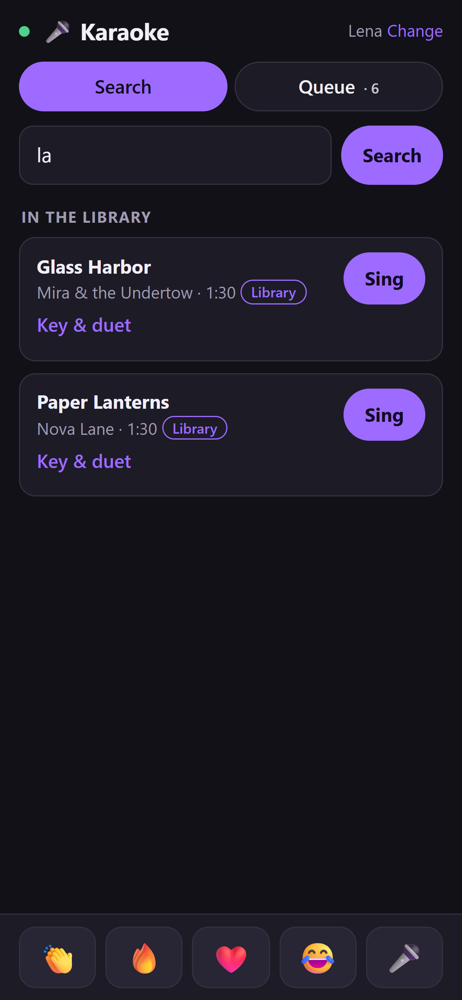
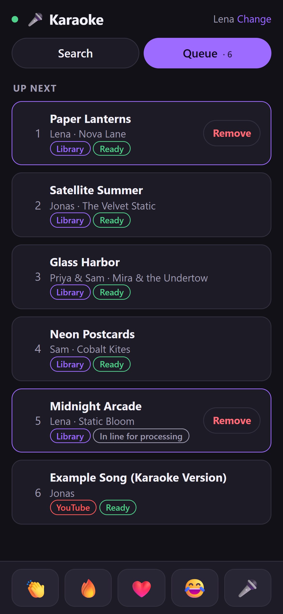
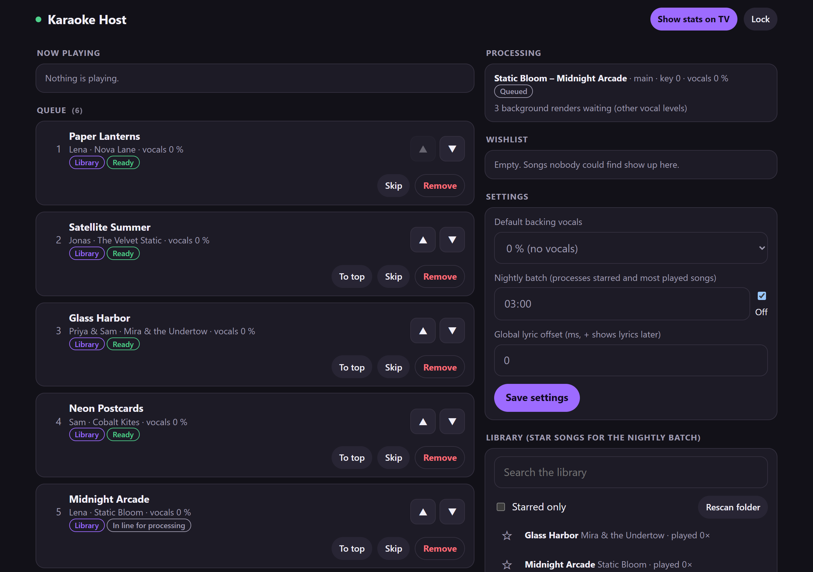

# Karaoke Party

LAN karaoke for house parties, with your own music. Guests scan a QR code on the TV, enter a name and queue songs on
their phones. Your PC removes the vocals from songs in your music library (Demucs) and syncs the lyrics word by word
(LRCLIB, or WhisperX transcription); the TV shows the lyrics while the instrumental plays. Songs that aren't in your
library can fall back to a karaoke video in the YouTube app on the TV.

<p>
  
  
</p>


(Screenshots use the made-up demo library from `scripts/demo_data.py`.)

**Bring your own music.** This repository contains no music, lyrics or video. Use it only with music you obtained
legally, in DRM-free files (mp3, m4a, flac, ogg, wav), and for private use at home. Lyrics are fetched from LRCLIB or
transcribed on your PC at runtime and stay on your PC. YouTube videos are only ever played in the YouTube app; nothing
is downloaded from YouTube.

## What runs where

| Part | Where | What |
|---|---|---|
| Server (`server/`) | your PC | API + WebSocket on port 8765, TV discovery on UDP 8766 |
| Worker | your PC, child process | Demucs, WhisperX, ffmpeg renders, one song at a time |
| Phone page (`web/`) | guests' phones | `http://<PC IP>:8765/`, from the QR code on the TV |
| Host page | any browser | `http://<PC IP>:8765/host`, protected by your PIN |
| TV app (`tvapp/`) | Android TV / Google TV | lobby with QR + queue, lyrics player, reactions, stats |

## Requirements

- **PC:** Windows 10/11 or Linux (x86-64), 16 GB RAM, ~15 GB free disk (Python environment ~6 GB, models ~4 GB)
  plus ~200 MB per processed song (stems and renders in `data/`).
- **GPU (recommended):** an NVIDIA GPU with a current driver (CUDA 12.8 support: driver 570 or newer; RTX 20-series and
  newer, including RTX 50-series). A song takes about a minute. **Without one** everything runs on the CPU: it works,
  but a song takes several minutes (often 5-15), so queue early or use the nightly batch. The host page shows a
  warning in that case. AMD/Intel GPUs and macOS aren't supported.
- **ffmpeg with the rubberband filter** (for key changes). The Windows installer downloads one if needed; on Linux the
  distribution's ffmpeg usually has it (Debian/Ubuntu, Fedora with RPM Fusion, Arch). The server checks at startup and
  tells you what to install.
- **TV:** Android TV or Google TV with Android 7.0 or newer (Sony, Philips, TCL, Hisense, Chromecast with Google TV,
  Google TV Streamer, Nvidia Shield, ...), on the same network as the PC.
- **For the TV setup:** `adb` (Android SDK Platform-Tools) on the PC, and Python 3.8+ for `scripts/tv_setup.py`.
- **Optional:** a YouTube Data API v3 key, for songs that aren't in your library (free quota: ~95 searches per day).

## Setup: PC

### Windows

1. Install [Git](https://git-scm.com/download/win) and clone the repo:
   ```powershell
   git clone https://github.com/maxlindnerhtl/karaoke-party.git
   cd karaoke-party
   ```
2. Run the installer (safe to run again):
   ```powershell
   powershell -ExecutionPolicy Bypass -File scripts\install.ps1
   ```
   It creates `.env` from `.env.example`, installs uv, Python 3.11 and the Python environment (several GB on the first
   run), checks that torch sees your GPU, and downloads an ffmpeg with rubberband if yours lacks it. Then it asks
   before the steps that need admin rights (a UAC prompt follows): firewall rules for TCP 8765 and UDP 8766 on
   **Private** networks only, and a Task Scheduler task that starts the server with a tray icon at logon (it runs
   without admin rights).
3. Fill in `.env` (see the comments in `.env.example`): `MUSIC_PATH` (your music folder; nothing is ever written
   there), `HOST_PIN` (pick one), optionally `YT_API_KEY`.
4. Set your network to **Private** (Settings → Network & internet → Wi-Fi/Ethernet → your network → Network profile
   type). The firewall rules only apply there.
5. Start it: log off and on, or run `.venv\Scripts\pythonw.exe -m server.tray`. The tray icon opens the host page.

Remove the firewall rules and the autostart task: `powershell -ExecutionPolicy Bypass -File scripts\install.ps1 -Uninstall`.

### Linux

1. Install git and ffmpeg (Debian/Ubuntu: `sudo apt install git ffmpeg curl`), and the NVIDIA driver if you have an
   NVIDIA GPU. Clone the repo:
   ```bash
   git clone https://github.com/maxlindnerhtl/karaoke-party.git
   cd karaoke-party
   ```
2. Run the installer (safe to run again; it never uses sudo without asking):
   ```bash
   scripts/install.sh
   ```
   It creates `.env`, installs uv, Python 3.11 and the environment, checks the GPU and ffmpeg, and installs a systemd
   user service `karaoke-party.service`. It prints (and offers to run) the firewall rules for ufw, and the
   `loginctl enable-linger` command if the server should start at boot without a login.
3. Fill in `.env` (`MUSIC_PATH`, `HOST_PIN`, optionally `YT_API_KEY`).
4. Start it: `systemctl --user start karaoke-party` (logs: `journalctl --user -u karaoke-party` and `data/logs/`).
   Without the service: `uv run python -m server`.

Remove the service: `scripts/install.sh --uninstall`.

### Check it

Open `http://<PC IP>:8765/` on a phone in the same Wi-Fi. If it doesn't load, see Troubleshooting.

## Setup: TV

1. **Turn on developer options:** Settings → Device Preferences → About (on some TVs: Settings → About, or System →
   About) → select **Build** 7 times until "You are now a developer" appears.
2. **Turn on debugging:** Settings → Device Preferences → Developer options → **USB debugging** on, and **Network
   debugging** / **ADB over network** on if your TV has it (older Android TVs). On Google TV and Android 11+ TVs,
   use **Wireless debugging** instead, or connect the TV with a USB cable. Note the TV's IP address (Settings →
   Network & Internet → your network).
3. **Install adb** ([SDK Platform-Tools](https://developer.android.com/tools/releases/platform-tools)) and put it on
   PATH (or set `ANDROID_HOME`).
4. **Download the APK** (`karaoke-party-<version>.apk`) from the
   [Releases page](https://github.com/maxlindnerhtl/karaoke-party/releases).
5. **Install it and grant YouTube end detection** in one go:
   ```bash
   python scripts/tv_setup.py --tv <TV IP> --apk karaoke-party-<version>.apk
   ```
   The TV asks "Allow USB debugging?" on the first connection: accept it (tick "Always allow"). For Wireless
   debugging, pair first (`adb pair <ip>:<pairing port>`, code from the TV) and pass `--tv <ip>:<port>`; for USB use
   `--serial <serial>` (see `adb devices`).

   What the script does, in case you want to do it by hand (`<pkg>` = `io.github.maxlindnerhtl.karaokeparty`,
   `<component>` = `<pkg>/com.karaoke.tv.yt.YtNotificationListener`):
   ```bash
   adb install -r karaoke-party-<version>.apk
   # Android 8 and newer:
   adb shell cmd notification allow_listener <component>
   # Android 7 (no allow_listener command): append to the existing list, keep its entries, separated by ':'
   adb shell settings get secure enabled_notification_listeners
   adb shell settings put secure enabled_notification_listeners "<existing entries>:<component>"
   # Android 10 and newer, optional: lets the app come back to the front by itself
   adb shell appops set <pkg> SYSTEM_ALERT_WINDOW allow
   ```
   The grant lets the app read YouTube's playback state, so YouTube songs return to the karaoke app when they end.
   Without it, YouTube songs return after a timer (video length + 60 s) and the lobby shows a hint with the command.
6. **First run:** open **Karaoke Party** from the TV's app list. It finds the server by itself (same network, server
   running); otherwise use "Enter server IP" on the offline screen. If you use YouTube songs, open the YouTube app once,
   sign in or choose "watch as guest", and pick a profile.

You can switch debugging off again afterwards; it's only needed for installing and the grant.

### Building the APK yourself

JDK 17 and the Android SDK (platform 35): `cd tvapp && ./gradlew assembleDebug`, then install
`tvapp/app/build/outputs/apk/debug/app-debug.apk` with `tv_setup.py --apk`. A debug build can't update a release build
(different signature): `adb uninstall io.github.maxlindnerhtl.karaokeparty` first.

## Using it

- **TV remote:** OK = play/pause · Left/Right = lyric timing ±0.1 s (saved per song) · Up/Down = backing vocals
  0/5/10/15 % · Back = pause and go to the lobby · hold OK or Menu = skip (asks first). In the lobby the next ready song
  starts after a 10 s countdown; OK starts it now, Back waits.
- **Phones:** search, queue (key shift, duet), remove your own entries, send reactions.
- **Host page:** reorder, skip, remove, wishlist, processing status, stars, "Show stats on TV", settings (default
  backing vocals, nightly batch time, global lyric offset).
- **Nightly batch:** with a time set on the host page, starred and the 20 most played songs get prepared at that time
  (if the PC is on within an hour after it).
- **Wake-on-LAN:** the TV's offline screen has a "Wake PC" button. It only works if the PC is on Ethernet with
  Wake-on-LAN enabled in the BIOS/UEFI and the network adapter; set `PC_MAC` if the PC uses Wi-Fi for the karaoke
  network but has an Ethernet port too.
- **Try it without music:** `uv run python scripts/demo_data.py create`, then start the server with
  `MUSIC_PATH=demo/music DATA_DIR=demo/data` (see the script's docstring).

## Troubleshooting

| Problem | Check |
|---|---|
| TV shows "Server offline" | Is the server running (tray icon / `systemctl --user status karaoke-party`)? Does `http://<PC IP>:8765/` load on a phone? Windows: network profile Private, firewall rules present (`Get-NetFirewallRule -Name KaraokeParty-*`). Linux: firewall (ufw/firewalld). Same network as the TV (guest Wi-Fi often isolates devices)? Use "Enter server IP" on the TV as a fallback. |
| "port 8765 is in use" | Another server instance runs (tray, service or `python -m server`). Stop it first, or set `PORT`. |
| "... has no rubberband filter" / "ffmpeg not found" | Install an ffmpeg with rubberband (the message says how for your OS) or set `FFMPEG_PATH` in `.env`. Check with `ffmpeg -hide_banner -filters`, which must list `rubberband`. |
| Songs take many minutes / host page says "No CUDA GPU found" | Processing runs on the CPU. With an NVIDIA GPU: install or update the driver (570+), then check `uv run python -c "import torch; print(torch.cuda.is_available())"`. Without one: queue early, use the nightly batch, or set `WHISPER_MODEL=small` for faster (less accurate) transcription. |
| Songs stay "Preparing" or fail | Host page → processing status, `data/logs/worker.log`. Retry failed entries on the host page. The first song downloads the models (~4 GB). |
| Windows asks to allow python.exe | Allow it on Private networks. Don't press Cancel: that creates a block rule that overrides the port rules. |
| YouTube song doesn't come back to the karaoke app | The notification-listener grant (TV setup step 5; the lobby shows the command if it's missing). Without it the app returns after video length + 60 s; Back in YouTube also returns. |
| YouTube shows "Who's watching?" or a sign-in screen | Pick a profile / sign in once with the remote. |
| YouTube search says the quota is used up | The free quota resets at midnight Pacific time; library songs keep working. |
| Lyrics out of sync | Left/Right on the remote during the song (saved per song), or the global offset on the host page. |
| `adb connect` refused / times out | Debugging switched off on the TV, wrong IP, or another adb client is connected (many TVs accept only one: `adb disconnect`). On Google TV use Wireless debugging (pair first) or USB. |
| `INSTALL_FAILED_UPDATE_INCOMPATIBLE` | A build with another signature is installed: `adb uninstall io.github.maxlindnerhtl.karaokeparty`, then install again. |
| The server crashed mid-song | Start it again. The TV keeps playing what it has buffered, continues a stalled song and reports songs that ended meanwhile once it reconnects. |

Logs: `data/logs/server.log`, `data/logs/worker.log`. TV app: `adb logcat -s Karaoke`.

## Development

- Tests: `uv run pytest` (no GPU, network or ML packages needed: `uv sync --no-group ml` is enough). TV app:
  `cd tvapp && ./gradlew testDebugUnitTest lintDebug`; instrumented tests on a device/emulator after
  `python scripts/tv_setup.py --serial <device> --grant-only`: `./gradlew connectedDebugAndroidTest`.
- CI (GitHub Actions) runs the server tests on Ubuntu and Windows, builds the APK, and runs the instrumented tests on
  Android TV emulators (API 24, 30, 34). Pushing a `v*` tag builds a signed APK and publishes it as a GitHub Release.
- `SPEC.md` is the full design and decision log; `CLAUDE.md` has conventions for contributors and coding agents.

## License

GPL-3.0-or-later, see [LICENSE](LICENSE). The server uses mutagen (GPL-2.0-or-later); the other dependencies are
under GPL-compatible licenses (MIT, BSD, Apache-2.0, LGPL). ffmpeg and Rubber Band (GPL) are not bundled: you install
them yourself. The Demucs, Whisper and alignment models are downloaded at runtime under their own licenses, and the
CUDA builds of PyTorch pull NVIDIA's CUDA libraries under NVIDIA's license when you install the environment.
YouTube is a trademark of Google LLC; this project isn't affiliated with or endorsed by Google, LRCLIB or the authors
of the models.
