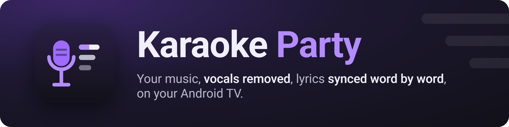
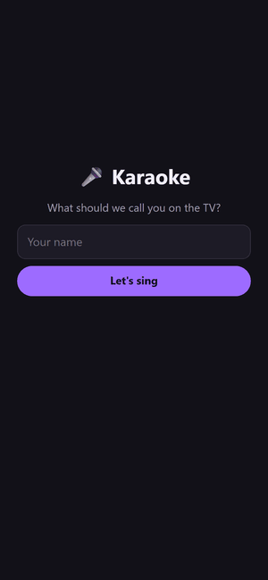
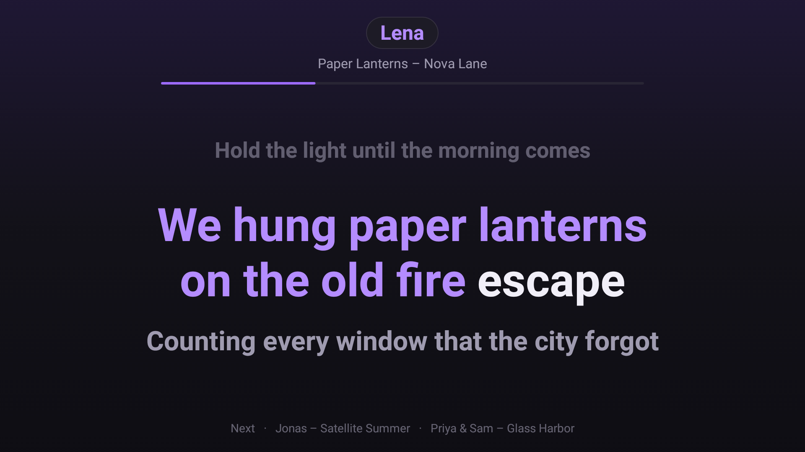
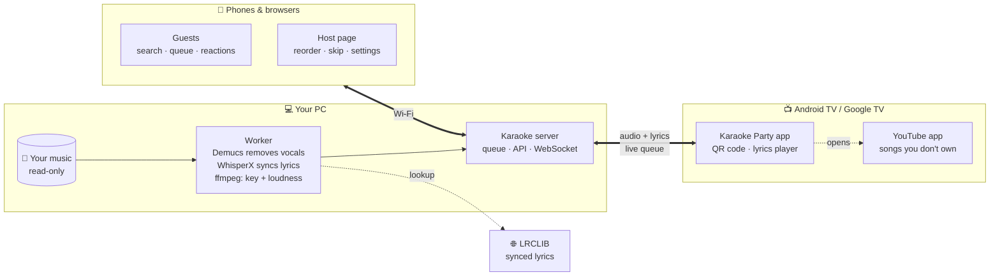
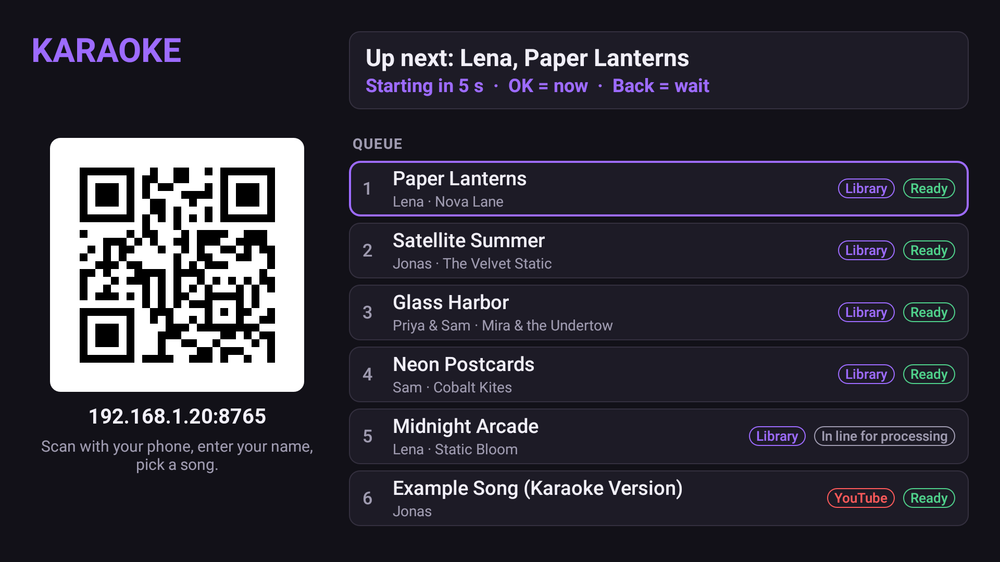
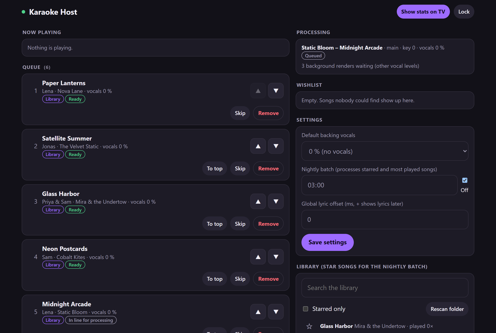

<p align="center">
  
</p>

<p align="center">
  <b>Turn your own music library into a karaoke night: guests queue songs from their phones, the TV shows the lyrics.<br>
  Set up and customized with Claude Code.</b>
</p>

<p align="center">
  <a href="https://github.com/maxlindnerhtl/karaoke-party/actions/workflows/ci.yml"></a>
  <a href="LICENSE"></a>
  <a href="https://github.com/maxlindnerhtl/karaoke-party/releases/latest"></a>
  
  
  <a href="PROMPT.md"></a>
</p>

<p align="center">
  
  &nbsp;&nbsp;
  
</p>

<p align="center">
  
</p>

<p align="center"><sub>All songs, artists, lyrics and guests in these images are made up (<code>scripts/demo_data.py</code>).</sub></p>

## Set it up with Claude Code

This project is meant to be installed and adapted by a coding agent: the setup touches your PC (Python, GPU, ffmpeg,
firewall) and your TV (adb, one permission), and an agent can check each step on your real devices, fix what's
different about your setup, and ask you before anything that needs your OK.

| Where | What to do |
|---|---|
| **1. On the TV** | Settings → Device Preferences → About → press OK on **Build** 7 times. Back → **Developer options** → **USB debugging** on, plus **Network debugging** / **ADB debugging** if your TV shows it (Google TV sets: **Wireless debugging**). Keep the TV on, on the same Wi-Fi as the PC. |
| **2. On your PC** | Open [Claude Code](https://claude.com/claude-code) in an empty folder and paste [`PROMPT.md`](PROMPT.md). |
| **3. Follow along** | Answer its questions (music folder, host PIN, autostart, YouTube key), accept **"Allow USB debugging?"** on the TV when it tells you, and scan the QR code at the end. |

Claude Code checks your GPU and ffmpeg, runs the installer, finds the TV and installs the app, grants the one
permission YouTube end detection needs (the right way for your Android version), starts the server and verifies it
with screenshots from the TV. It asks before anything that needs admin rights, and at the end tells you how to
switch ADB off again. It changes nothing else on the TV and never writes to your music folder ([`CLAUDE.md`](CLAUDE.md)
has the rules it follows).

**You need:** a Windows 10/11 or Linux PC with your music (an NVIDIA GPU makes it fast; without one it still works,
slower), an Android TV or Google TV with Android 7.0 or newer, and Claude Code. Samsung (Tizen), LG (webOS), Roku and
Apple TV won't work; an Android TV stick on an HDMI port does. Prefer doing it by hand? See [Manual setup](#manual-setup).

## How it works

Your PC does the heavy lifting: it removes the vocals from songs in **your own music folder** and syncs the lyrics word
by word. Guests join by scanning the QR code on the TV; the TV app plays the instrumental and shows the lyrics.



Everything stays on your home network. The only internet services are LRCLIB (lyrics) and, optionally, the YouTube
Data API for songs you don't own.

<p align="center">
  
</p>

## Features

- 🎤 **Vocals removed** from your own songs (Demucs), with **0 / 5 / 10 / 15 % backing vocals** switchable on the remote
- 📝 **Word-by-word lyrics**: synced lyrics from LRCLIB aligned to the voice, or transcribed by WhisperX when there are none
- 🎚️ **Key change** (−3 to +3 semitones) per entry, and every song **loudness-matched**
- 📱 **No app for guests**: scan the QR code, type a name, search, queue, send emoji reactions
- 🔄 **Fair queue**: round-robin between guests, duets with two singers, a host page to reorder and skip
- ▶️ **YouTube fallback**: songs you don't own play as karaoke videos in the YouTube app and return to the queue when they end
- 📺 **Made for the remote**: big, readable lyrics on any 1080p Android TV / Google TV with Android 7.0 or newer
- ⚡ **Fast with an NVIDIA GPU** (about a minute per song), still works on the CPU (slower)
- 🛡️ **Robust at parties**: survives server restarts and TV reboots mid-song, picks up where it was
- 🌙 Extras: nightly pre-processing of favorites, party stats on the TV, Wake-on-LAN from the TV

<p align="center">
  
</p>

## Customize it with Claude Code

The whole system is small and documented for agents: [`SPEC.md`](SPEC.md) describes how every part works and why
(with a decision log), and [`CLAUDE.md`](CLAUDE.md) has the conventions, safety rules and known gotchas. Open Claude
Code in your clone and ask for what you want; it reads both, makes the change, runs the tests and checks the result
on your TV. Some ideas:

> Change the TV app and the phone pages to a teal and orange theme, keep the contrast readable from the sofa, and show
> me screenshots from the TV before you install it.

> Add a "Shuffle" button to the host page that fills the queue with three random starred songs when it's empty.

> Translate the phone page, the host page and the TV app into German (my guests' phones are in German, so pick the
> language from the browser and the TV's locale).

> Processing is too slow on my laptop without a GPU. Make it faster even if the lyrics timing gets a bit less exact,
> and tell me what you traded off.

> Show the singer's name big on the TV for five seconds before each song starts, with a short countdown.

Keep your changes on a branch (or a fork) so you can pull updates later; Claude Code can merge them for you.

## Using it

| Where | What you can do |
|---|---|
| **TV remote** | OK = play/pause · ◀ ▶ = lyric timing ±0.1 s (saved per song) · ▲ ▼ = backing vocals 0/5/10/15 % · Back = pause, lobby · hold OK = skip. The next ready song starts after a 10 s countdown. |
| **Phones** | `http://<PC IP>:8765/` from the QR code: search, queue (key shift, duet), remove your own entries, send reactions |
| **Host page** `/host` | reorder, skip, remove, wishlist, processing status, stars, "Show stats on TV", settings (PIN from `.env`) |
| **Nightly batch** | set a time on the host page: starred and most-played songs get prepared overnight |
| **Wake-on-LAN** | "Wake PC" on the TV's offline screen (PC on Ethernet with WoL enabled; `PC_MAC` for another adapter) |

**Try it without music:** `uv run python scripts/demo_data.py create` builds a small made-up library with ready
renders; the script's docstring shows how to start a server on it.

## Manual setup

The same steps the prompt runs, if you'd rather do them yourself.

| | Needed | Notes |
|---|---|---|
| **PC** | Windows 10/11 or Linux (x86-64), 16 GB RAM, ~15 GB free disk | +~200 MB per processed song |
| **GPU** | recommended: NVIDIA, driver 570+ (CUDA 12.8) | RTX 20-series and newer, incl. RTX 50. Without one: CPU, several minutes per song |
| **ffmpeg** | with the **rubberband** filter (key changes) | the Windows installer gets one; on Linux the distro's ffmpeg usually has it |
| **TV** | Android TV / Google TV, Android 7.0+ | Sony, Philips, TCL, Hisense, Xiaomi, Chromecast with Google TV, Google TV Streamer, Shield, ... |
| **For TV setup** | `adb` (Platform-Tools) + Python 3.8+ | only once, for installing and one permission |
| **Optional** | YouTube Data API v3 key | free quota ≈ 95 searches per day |

<details>
<summary><b>🪟 Windows</b></summary>

1. Install [Git](https://git-scm.com/download/win) and clone the repo:
   ```powershell
   git clone https://github.com/maxlindnerhtl/karaoke-party.git
   cd karaoke-party
   ```
2. Run the installer (safe to run again):
   ```powershell
   powershell -ExecutionPolicy Bypass -File scripts\install.ps1
   ```
   It creates `.env` from `.env.example`, installs uv, Python 3.11 and the Python environment (several GB on the
   first run), checks that torch sees your GPU, and downloads an ffmpeg with rubberband if yours lacks it. Then it
   asks before the steps that need admin rights (a UAC prompt follows): firewall rules for TCP 8765 and UDP 8766 on
   **Private** networks only, and a Task Scheduler task that starts the server with a tray icon at logon (it runs
   without admin rights).
3. Fill in `.env` (see the comments in `.env.example`): `MUSIC_PATH` (your music folder; nothing is ever written
   there), `HOST_PIN` (pick one), optionally `YT_API_KEY`.
4. Set your network to **Private** (Settings → Network & internet → Wi-Fi/Ethernet → your network → Network profile
   type). The firewall rules only apply there.
5. Start it: log off and on, or run `.venv\Scripts\pythonw.exe -m server.tray`. The tray icon opens the host page.
6. Check it: open `http://<PC IP>:8765/` on a phone in the same Wi-Fi.

Remove the firewall rules and the autostart task:
`powershell -ExecutionPolicy Bypass -File scripts\install.ps1 -Uninstall`.

</details>

<details>
<summary><b>🐧 Linux</b></summary>

1. Install git and ffmpeg (Debian/Ubuntu: `sudo apt install git ffmpeg curl`), and the NVIDIA driver if you have an
   NVIDIA GPU. Clone the repo:
   ```bash
   git clone https://github.com/maxlindnerhtl/karaoke-party.git
   cd karaoke-party
   ```
2. Run the installer (safe to run again; it never uses sudo without asking):
   ```bash
   scripts/install.sh
   ```
   It creates `.env`, installs uv, Python 3.11 and the environment, checks the GPU and ffmpeg, and installs a systemd
   user service `karaoke-party.service`. It prints (and offers to run) the firewall rules for ufw, and the
   `loginctl enable-linger` command if the server should start at boot without a login.
3. Fill in `.env` (`MUSIC_PATH`, `HOST_PIN`, optionally `YT_API_KEY`).
4. Start it: `systemctl --user start karaoke-party` (logs: `journalctl --user -u karaoke-party` and `data/logs/`).
   Without the service: `uv run python -m server`.
5. Check it: open `http://<PC IP>:8765/` on a phone in the same Wi-Fi.

Remove the service: `scripts/install.sh --uninstall`.

</details>

<details>
<summary><b>📺 TV (Android TV / Google TV)</b></summary>

1. **Turn on developer options:** Settings → Device Preferences → About (on some TVs: Settings → About, or System →
   About) → select **Build** 7 times until "You are now a developer" appears.
2. **Turn on debugging:** Settings → Device Preferences → Developer options → **USB debugging** on, and **Network
   debugging** / **ADB over network** on if your TV has it (older Android TVs). On Google TV and Android 11+ TVs, use
   **Wireless debugging** instead, or a USB cable. Note the TV's IP address (Settings → Network & Internet).
3. **Install adb** ([SDK Platform-Tools](https://developer.android.com/tools/releases/platform-tools)) and put it on
   PATH (or set `ANDROID_HOME`).
4. **Download the APK** (`karaoke-party-<version>.apk`) from the
   [Releases page](https://github.com/maxlindnerhtl/karaoke-party/releases).
5. **Install it and grant YouTube end detection** in one go:
   ```bash
   python scripts/tv_setup.py --tv <TV IP> --apk karaoke-party-<version>.apk
   ```
   The TV asks "Allow USB debugging?" on the first connection: accept it (tick "Always allow"). For Wireless
   debugging, pair first (`adb pair <ip>:<pairing port>`, code from the TV) and pass `--tv <ip>:<port>`; for USB use
   `--serial <serial>` (see `adb devices`).
6. **First run:** open **Karaoke Party** from the TV's app list. It finds the server by itself (same network, server
   running); otherwise use "Enter server IP" on the offline screen. For YouTube songs, open the YouTube app once, sign
   in or choose "watch as guest", and pick a profile.
7. **Switch ADB off again:** Developer options → USB debugging off, Network/Wireless debugging off, "Revoke USB
   debugging authorizations". The app and its permission stay.

**What `tv_setup.py` does**, if you prefer doing it by hand (`<pkg>` = `io.github.maxlindnerhtl.karaokeparty`,
`<component>` = `<pkg>/com.karaoke.tv.yt.YtNotificationListener`):

```bash
adb install -r karaoke-party-<version>.apk
# Android 8 and newer:
adb shell cmd notification allow_listener <component>
# Android 7 (no allow_listener command): append to the existing list, keep its entries, separated by ':'
adb shell settings get secure enabled_notification_listeners
adb shell settings put secure enabled_notification_listeners "<existing entries>:<component>"
# Android 10 and newer, optional: lets the app come back to the front by itself
adb shell appops set <pkg> SYSTEM_ALERT_WINDOW allow
```

The permission lets the app read YouTube's playback state, so YouTube songs return to the karaoke app when they end.
Without it, YouTube songs return after a timer (video length + 60 s), and the lobby shows the command to run.

**Building the APK yourself:** JDK 17 and the Android SDK (platform 35): `cd tvapp && ./gradlew assembleDebug`, then
install `tvapp/app/build/outputs/apk/debug/app-debug.apk` with `tv_setup.py --apk`. A debug build can't update a
release build (different signature): `adb uninstall io.github.maxlindnerhtl.karaokeparty` first.

</details>

## Troubleshooting

Easiest: open Claude Code in your clone and describe what's wrong; it knows the gotchas below (`CLAUDE.md`).

<details>
<summary><b>The TV shows "Server offline"</b></summary>

- Is the server running (tray icon, or `systemctl --user status karaoke-party`)? Does `http://<PC IP>:8765/` load on a
  phone?
- Windows: network profile **Private**, firewall rules present (`Get-NetFirewallRule -Name KaraokeParty-*`). If
  Windows asked to allow python.exe and someone pressed Cancel, that created a block rule: allow it on Private
  networks in Windows Defender Firewall.
- Linux: allow TCP 8765 and UDP 8766 in ufw/firewalld (`scripts/install.sh` prints the commands).
- Same network as the TV? Guest Wi-Fi networks often isolate devices.
- Fallback: "Enter server IP" on the TV.

</details>

<details>
<summary><b>"… has no rubberband filter" / "ffmpeg not found"</b></summary>

Install an ffmpeg with rubberband (the error message says how for your OS) or set `FFMPEG_PATH` in `.env`. Check with
`ffmpeg -hide_banner -filters`: it must list `rubberband`.

</details>

<details>
<summary><b>Songs take many minutes / the host page says "No CUDA GPU found"</b></summary>

Processing runs on the CPU. With an NVIDIA GPU, install or update the driver (570+) and check
`uv run python -c "import torch; print(torch.cuda.is_available())"`. Without one: queue early, use the nightly batch,
or set `WHISPER_MODEL=small` for faster (less accurate) transcription.

</details>

<details>
<summary><b>Songs stay "Preparing" or fail</b></summary>

Look at the processing status on the host page and `data/logs/worker.log`, and retry failed entries there. The first
song downloads the models (~4 GB), so it takes longer.

</details>

<details>
<summary><b>A YouTube song doesn't come back to the karaoke app</b></summary>

The notification-listener permission is missing (rerun `scripts/tv_setup.py`; the lobby shows the command when it's
missing). Without it the app returns after video length + 60 s; Back in YouTube also returns. If YouTube shows "Who's
watching?" or a sign-in screen, pick a profile once with the remote.

</details>

<details>
<summary><b>More problems</b></summary>

| Problem | Fix |
|---|---|
| "port 8765 is in use" | Another server instance runs (tray, service or `python -m server`). Stop it, or set `PORT`. |
| YouTube search says the quota is used up | The free quota resets at midnight Pacific time; library songs keep working. |
| Lyrics out of sync | ◀ ▶ on the remote during the song (saved per song), or the global offset on the host page. |
| `adb connect` refused / times out | Debugging switched off, wrong IP, or another adb client is connected (many TVs accept only one: `adb disconnect`). On Google TV use Wireless debugging (pair first) or USB. |
| `INSTALL_FAILED_UPDATE_INCOMPATIBLE` | A build with another signature is installed: `adb uninstall io.github.maxlindnerhtl.karaokeparty`, then install again and rerun `tv_setup.py`. |
| The server crashed mid-song | Start it again. The TV keeps playing what it buffered, continues a stalled song and reports songs that ended meanwhile. |

Logs: `data/logs/server.log`, `data/logs/worker.log`; TV app: `adb logcat -s Karaoke`.

</details>

## Development

- Server tests: `uv run pytest` (no GPU, network or ML packages needed; `uv sync --no-group ml` is enough).
- TV app: `cd tvapp && ./gradlew testDebugUnitTest lintDebug`; instrumented tests on a device or emulator after
  `python scripts/tv_setup.py --serial <device> --grant-only`: `./gradlew connectedDebugAndroidTest`.
- CI runs the server tests on Ubuntu and Windows, builds the APK, and runs the instrumented tests on Android TV
  emulators (API 24, 30, 34). A `v*` tag builds a signed APK and publishes it as a GitHub Release.
- README images: `scripts/readme_images.py` (banner, phone and host pages; made-up demo data only). The TV images are
  screenshots from a real TV playing the demo library (`adb exec-out screencap -p`), with the PC address in the lobby
  replaced by a placeholder.

## How this was built

Karaoke Party was designed and built with Claude Code, in phases from a written spec. [`SPEC.md`](SPEC.md) came first:
goals, hard rules (no downloads from YouTube, the music folder is read-only) and the architecture. Then each phase was
planned, implemented, tested on the real PC and TV, committed and reviewed before the next one: a spike to validate
the risky parts (GPU separation, lyric alignment, playing audio on a 2015 Android TV, reading YouTube's playback
state), the server and processing pipeline, the phone and host pages, the TV app, packaging, and finally a simulated
15-song party that broke things on purpose (killing the server mid-song, rebooting the TV) and fixed what it found.
Every decision that changed along the way is in SPEC.md's decision log. Making it portable for this public release
(Linux, CPU fallback, newer Android versions, CI on emulators) was a Claude Code session too.

## License and your music

**Bring your own music.** This repository contains **no music, lyrics or video**. Use Karaoke Party only with music you
obtained legally, in **DRM-free** files (mp3, m4a, flac, ogg, wav), for private use at home. Lyrics are fetched from
LRCLIB or transcribed on your PC at runtime and stay on your PC. YouTube videos are only ever played in the YouTube
app; nothing is downloaded from YouTube or any other site.

Karaoke Party is licensed under the **GNU General Public License v3.0 or later**, see [LICENSE](LICENSE). The server
uses mutagen (GPL-2.0-or-later); the other dependencies are under GPL-compatible licenses (MIT, BSD, Apache-2.0,
LGPL). ffmpeg and Rubber Band (GPL) are not bundled: you install them yourself. The Demucs, Whisper and alignment
models are downloaded at runtime under their own licenses, and the CUDA builds of PyTorch pull NVIDIA's CUDA libraries
under NVIDIA's license when you install the environment.

YouTube is a trademark of Google LLC. Claude and Claude Code are products of Anthropic. This project isn't affiliated
with or endorsed by Google, Anthropic, LRCLIB or the authors of the models.
